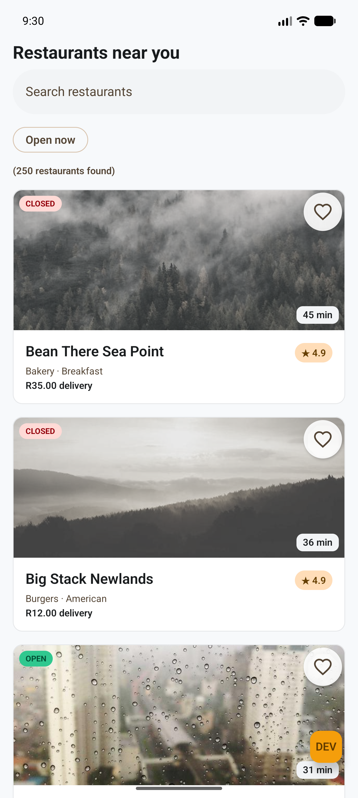
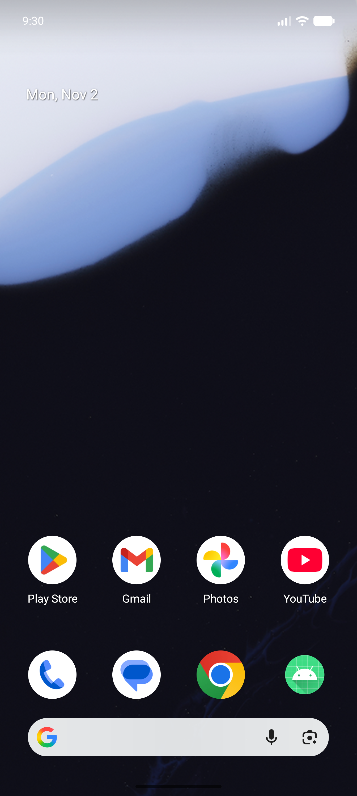
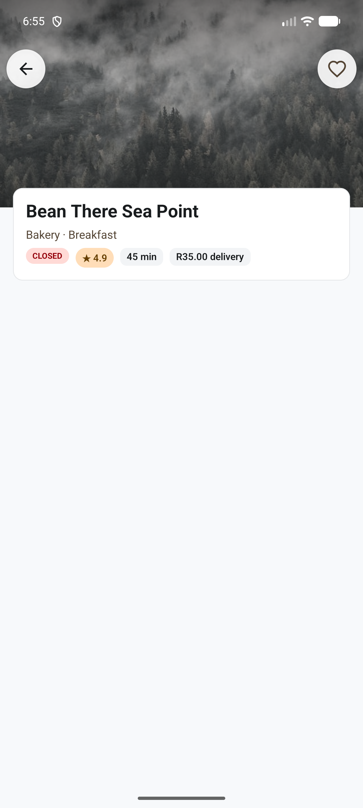
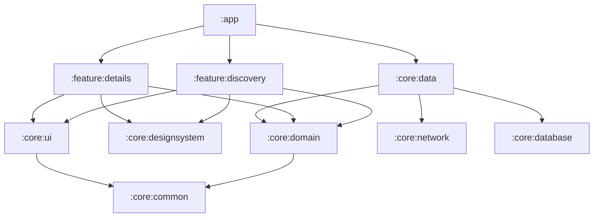

# Mr D Restaurant Discovery

A native Android mini-app for browsing nearby restaurants, built for the OfferZen technical vetting
assignment. Kotlin and Jetpack Compose, offline-first, split into modules the way a large app
maintained by several squads would be.

| List | Offline banner | Error | Details |
|---|---|---|---|
|  |  |  |  |

## What it does

- Scrollable list of 250 restaurants: name, cuisines, rating, estimated time, open or closed, delivery fee
- Search by name (debounced) and an "Open now" toggle
- Details screen for a restaurant, with image, rating, ETA, fee and status
- Distinct states for loading, empty results, errors, and "cached data, but the refresh failed"
- **Offline baseline:** the last successful list is stored on the device. A failed refresh never
  damages what the user can already see, and a clear message with a retry is shown
- Favorites from either screen, persisted across restarts
- Deep link: `mrd://restaurant/{id}`
- Search text, the filter and the scroll position survive rotation and process death

## Run it

**You need:** a recent stable Android Studio that supports the Android Gradle Plugin version in
`gradle/libs.versions.toml`, JDK 17 (the one bundled with Studio works), the Android SDK platform
the project compiles against (Studio offers to install it), and an emulator or device on Android 8.0
(API 26) or newer. No API keys or accounts are needed.

1. Clone the repository and open it in Android Studio. Let Gradle sync.
2. Run the `app` configuration on an emulator or device, or from a terminal:

   ```
   ./gradlew installDebug
   adb shell am start -n com.mrd.discovery/.MainActivity
   ```

### The mock backend

The brief allows any mock data source. This app calls a real Retrofit API, and an OkHttp interceptor
answers every request from `core/network/src/main/assets/restaurants.json` with simulated latency,
so networking, error handling and offline behaviour are all exercised for real. The dataset is
generated by `tools/generate_restaurants.py` (fixed seed) and deliberately contains missing fields
and two unusable records.

### Demo controls (debug builds only)

A **DEV** button in the corner opens a dialog that switches the mock backend between
**Normal**, **Offline**, **Timeout** and **ServerError**, and sets the latency. A change applies to
the next refresh: pull down on the list, or tap **Retry**.

The app can also start in a chosen state from the command line, which is how to reach the error
screen (it needs a failed first load):

```
adb shell pm clear com.mrd.discovery
adb shell am start -n com.mrd.discovery/.MainActivity --es backend_mode Offline
adb shell am start -n com.mrd.discovery/.MainActivity --el backend_latency_ms 3000
```

Open a restaurant by deep link:

```
adb shell am start -W -a android.intent.action.VIEW -d "mrd://restaurant/r-1001" com.mrd.discovery
```

Release builds contain none of the controls.

## Tests and checks

```
./gradlew spotlessCheck lintDebug testDebugUnitTest assembleDebug   # what CI runs
tools/check_standards.sh                                            # architecture and coding rules
./gradlew :core:database:connectedDebugAndroidTest :feature:discovery:connectedDebugAndroidTest :app:connectedDebugAndroidTest
```

The last line needs an emulator: the database queries run against real SQLite, the screens are
driven through every state, and the app tests cover deep links and state restoration.

## Architecture



- Features depend only on `core` modules, never on each other. `:app` is the single place that
  connects them, so the two features could be owned by different squads.
- Screens are stateless composables; ViewModels expose a `StateFlow`. Every read comes from Room,
  and one repository decides when to refresh from the network.
- Build logic lives in `build-logic` as convention plugins, so each module's build file is a few lines.

More detail, trade-offs and how this would scale is in [SOLUTION.md](SOLUTION.md).

## Documents

- [SOLUTION.md](SOLUTION.md): design decisions, scaling, testing, performance, AI-assisted workflow
- [docs/CODING_STANDARDS.md](docs/CODING_STANDARDS.md): the rules the build enforces
- [docs/GIT_WORKFLOW.md](docs/GIT_WORKFLOW.md): branches, commits and pull requests
- [docs/DEMO_SCRIPT.md](docs/DEMO_SCRIPT.md): the walkthrough used for the video

## Known limitations

Search uses a SQL `LIKE` scan, which is fine for hundreds of rows but not for a huge catalogue.
The theme is light only (the designs define no dark scheme) and uses the system font. Instrumented
tests need an emulator and are not run in CI. Details are in SOLUTION.md.
