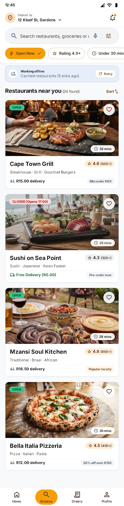
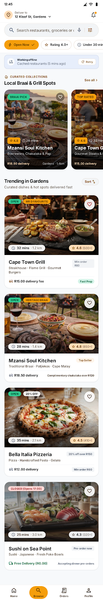
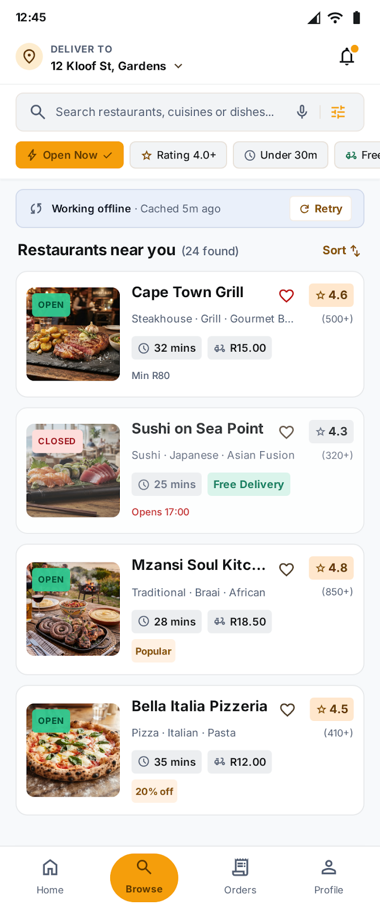
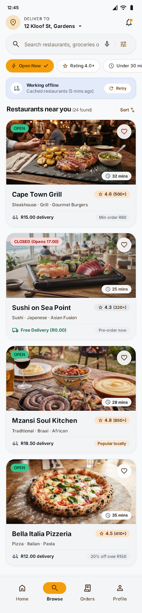
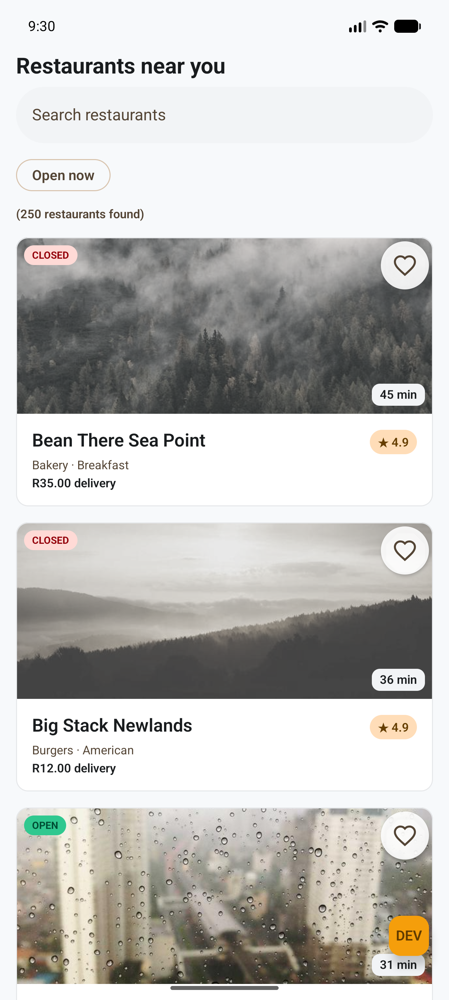
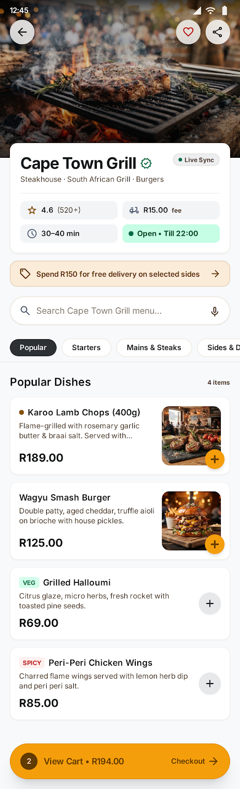
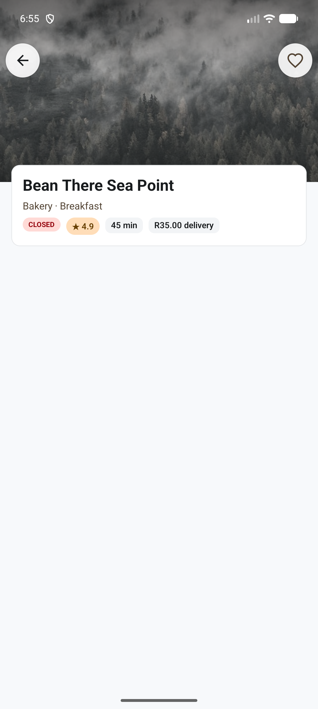

# Design

## How the design was produced

The assessment brief was entered into Google Stitch. It produced the Discovery and Details screens
and a design system called "Mzansi Express Food" (Material 3, Inter). Stitch was then asked for three
variations of the Discovery screen. Those designs were used as input for the Compose UI, not copied:
the exported colour, type, shape and spacing tokens became the theme in `:core:designsystem`, and the
screens were rebuilt as composables.

| Design | Variation: Editorial | Variation: High density | Variation: Material 3 Expressive |
|---|---|---|---|
|  |  |  |  |
| The base screen | Curated carousel, taller hero cards with promo badges, distances | Compact rows with 96 dp thumbnails, more restaurants per screen | Tonal cards with 24 px corners, larger header, pill-shaped controls |

The exports are in [design/source](design/source), including the design system file.

## What was taken from the variations

Nothing was taken from the variations. They were compared against the base design, and the base
design was kept: the timebox meant committing to one design early, and it already covered the brief.
The Editorial carousel and the High-density rows are the most likely things to try in a second iteration.

## Design next to the app

| Design | App |
|---|---|
|  |  |
|  |  |

## From design to code

| In the design | In the code |
|---|---|
| Colour tokens (`primary-container` amber `#F59E0B`, `primary` brown `#855300`, `tertiary` green `#006C49`, error, surface scale) | `Color.kt`, a Material 3 light colour scheme |
| Type scale (10 to 32 sp, Inter) | `Type.kt`, same sizes, line heights and weights |
| Corner radii and spacing (4 to 32) | `Shape.kt`, `MrDSpacing` |
| Restaurant card: image, OPEN/CLOSED pill, ETA pill, rating pill, cuisines, fee, muted when closed | `RestaurantCard`, `StatusBadge`, `InfoChip`, `RatingPill`, `MrDImage` |
| Pill search bar and the "Open Now" chip | `MrDSearchBar`, `MrDFilterChip` |
| "Working offline" banner with Retry | `OfflineBanner` |
| Details hero behind the status bar with an overlapping info card | `DetailsScreen`, `StatusBarIconsEffect` |
| Back and favorite buttons | `BackButton`, `FavoriteButton` (vector icons drawn in code) |

## A conflict inside the design system

The design system's text and its token table disagree. The text names Sun Amber `#F59E0B` as the
primary colour, with Deep Slate `#1E293B` as secondary and Fresh Mint `#10B981` as tertiary. The token
table, which is also the palette the exported screens use, has `primary` `#855300`, with `#F59E0B`
only as `primary-container`, `secondary` `#545F73` and `tertiary` `#006C49`. The app follows the token
table, so the amber appears on chips, the selected state and the call to action, as in the screens.

## What was deliberately left out

The brief limits search to a name and one "Open now" toggle, and asks for a browse screen and a
details screen. The data model has no field behind the rest, so it was not built:

- Bottom navigation, the "Deliver to" header, the notification bell, and the voice and filter icons in the search bar
- The Rating 4.0+, Under 30 mins, Free Delivery and Price chips, and Sort
- Per-card text with no data behind it: review counts, "Min order", offers, "Opens 17:00", distances
- From the Editorial variation: the carousel, the promo badges and the section titles
- On details: the verified badge, the "Live Sync" pill, the share button, the promotion banner, and
  the menu, its search, its category tabs and the cart bar

## Where the app differs from the design

- **Font:** the design uses Inter; the app uses the system font with the same sizes and weights,
  because no font files are bundled.
- **Theme:** light only, because the design defines no dark scheme.
- **Images:** placeholder photos, not the generated food images, whose Google-hosted URLs cannot be relied on.
- **Icons:** the heart and back arrow are drawn as vectors in code, so no icon library is added.
- **Offline banner:** the wording is "Showing saved restaurants (synced N min ago)" and is driven by
  real sync state, where the design shows a fixed string.
- **Colours:** the design system's text and its token table disagree (the text says primary is
    `#F59E0B`, the tokens say `#855300` with `#F59E0B` as `primary-container`). The app follows the
    tokens, which the exported screens also use. White on `#F59E0B` is only about 2.1:1 contrast, below
    the 4.5:1 AA minimum, while `#855300` is about 6.5:1. The amber is kept for chips, the selected state
    and the call to action.
